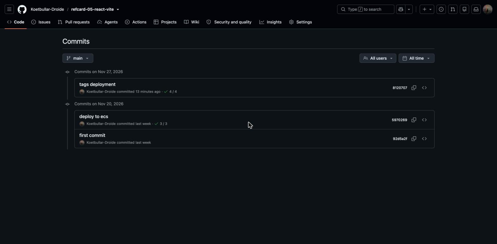
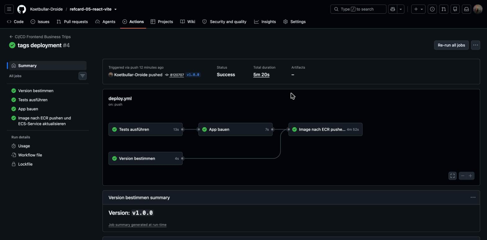
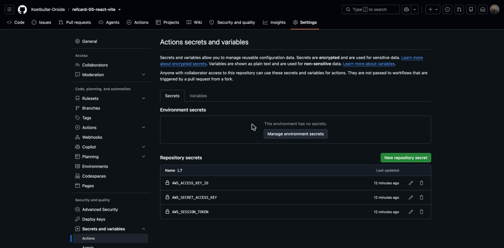
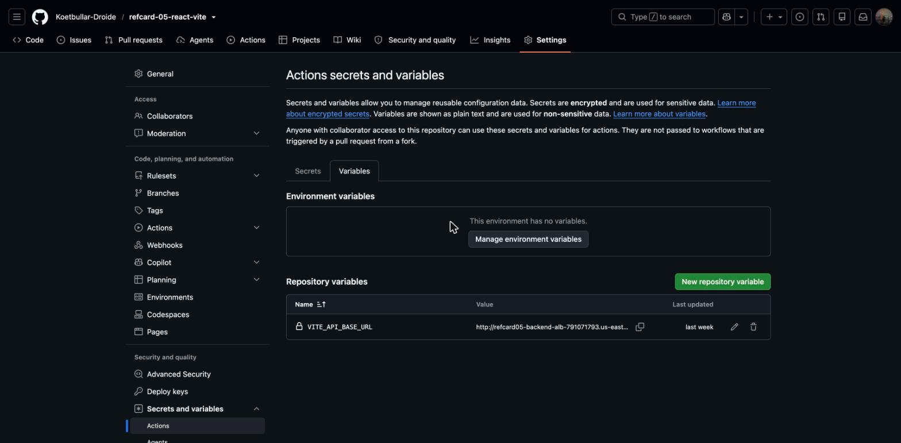
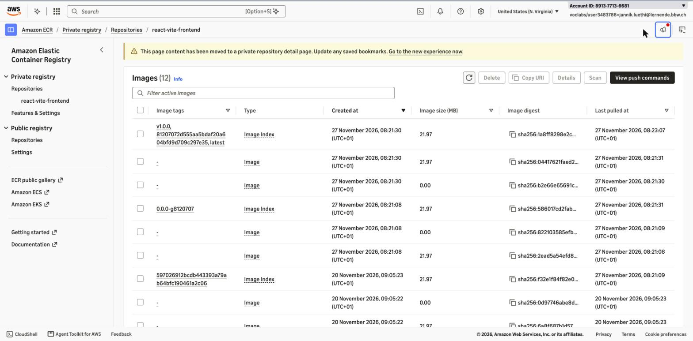
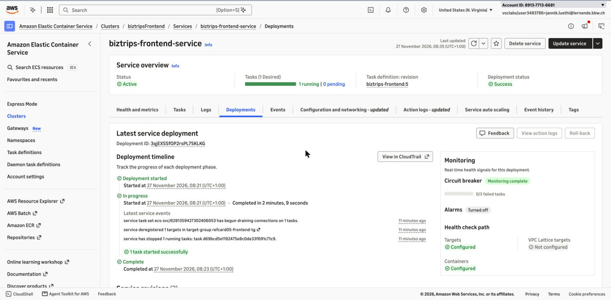

# RefCard 05 – React + Vite Frontend auf AWS (ECR, ECS)

Frontend der BusinessTrips-Applikation (Trip-Liste + Wishlist). Teil der CI/CD-Übungssequenz
**RefCard 02–05** (siehe [`docs/future/RefCard-03-RefCard-05-own-repos.md`](docs/future/RefCard-03-RefCard-05-own-repos.md)).
Dieses Repository ist der **Frontend-Teil von RefCard 05**: statischer Vite-Build, ausgeliefert
von nginx in einem Container auf ECS Fargate.

| Teil | Wo |
| --- | --- |
| Frontend (dieses Repo) | http://refcard05-frontend-alb-321770531.us-east-1.elb.amazonaws.com |
| Backend | Repo [`refcard-08-springboot-backend`](https://github.com/Koetbullar-Droide/refcard-08-springboot-backend) |
| Lokale Gesamtumgebung | Repo `refcard-05-compose` (Frontend + Backend + MariaDB mit Docker Compose) |

## Lokal entwickeln

```bash
npm install
npm run dev      # http://localhost:5173, Backend muss auf http://localhost:8080 laufen
npm test         # Vitest
```

Die Backend-URL kommt aus `VITE_API_BASE_URL` (`.env`, Default `http://localhost:8080/`). `.env`
enthält keine Geheimnisse und wird nicht ins Docker-Image kopiert (`.dockerignore`).

Für Frontend, Backend und Datenbank zusammen siehe das Compose-Repo (`docker compose up --build`).

## Docker-Image

Multi-Stage-Build: Node baut `dist/`, das finale Image enthält nur nginx und die statischen Dateien
([`nginx.conf`](nginx.conf) mit SPA-Fallback auf `index.html`).
`VITE_API_BASE_URL` wird als **Build-Arg** übergeben, weil Vite den Wert beim Build fest ins JS einkompiliert.
Beim Build entsteht ausserdem `/version.json` mit Version und Commit.

```bash
docker build --build-arg VITE_API_BASE_URL=http://localhost:8080/ -t biztrips-frontend .
docker run --rm -p 3000:80 biztrips-frontend   # → http://localhost:3000, Version: /version.json
```

## Deployment auf AWS (RefCard 05)

```
Browser ─► ALB refcard05-frontend-alb :80 ─► Target Group (ip, :80, /) ─► ECS-Service (Fargate, nginx)
   └── JS ruft auf ─► ALB refcard05-backend-alb ─► Backend-Service (siehe Backend-Repo) ─► RDS / S3
```

| Ressource | Name |
| --- | --- |
| ECR-Repository | `react-vite-frontend` |
| ECS-Cluster / Service | `biztripsFrontend` / `biztrips-frontend-service` |
| Task Definition | `biztrips-frontend` ([`task-definition.json`](task-definition.json)), 0.25 vCPU / 512 MB |
| Load Balancer | `refcard05-frontend-alb` → http://refcard05-frontend-alb-321770531.us-east-1.elb.amazonaws.com |

### Pipeline ([`.github/workflows/deploy.yml`](.github/workflows/deploy.yml))

```
version ─┐
test ──► build ─┴─► deploy-ecs: Lab-Session prüfen → ECR-Login → Image bauen/pushen
                                → Task Definition rendern → ECS-Service aktualisieren → Smoke-Test
```

- `test` und `build` laufen bei jedem Push und Pull Request (npm-Cache über `setup-node`).
- `deploy-ecs` läuft bei Push auf `main` und bei Tags `v*.*.*`.
- **Repository-Variable** `VITE_API_BASE_URL` = URL des Backend-Load-Balancers (mit `/` am Ende).
  Fehlt sie, bricht der Job mit einer klaren Meldung ab.
- **Redeploy**: Die Task Definition bekommt das neue Image (`react-vite-frontend:<version>`). ECS startet
  einen neuen Task, wartet bis er gesund ist und stoppt dann den alten (Rolling Update, Circuit Breaker mit Rollback).
- **Smoke-Test**: Nach dem Deploy holt die Pipeline `/version.json` über den ALB. Der Job ist nur
  grün, wenn genau die neue Version ausgeliefert wird.
- **Health-Checks**: Container (`wget` auf `/` alle 30 s) und Target Group des ALB.

### Versionierung (Git-Tags → Image-Tag in ECR)

Gleiches Schema wie im Backend: SemVer-Git-Tags, Image-Tag über `git describe`.

| Situation | Image-Tag | Beispiel |
| --- | --- | --- |
| Release-Tag | `<tag>` | `v1.1.0` |
| Commits nach dem Tag | `<tag>-<n>-g<sha>` | `v1.1.0-1-g5970269` |
| noch kein Tag | `0.0.0-g<sha>` | `0.0.0-g5970269` |

Dazu kommen immer `<commit-sha>` und `latest`, und die Version steht als Image-Label im Image.

```bash
git tag -a v1.1.0 -m "Health-Checks, Versionierung"
git push origin v1.1.0
curl http://refcard05-frontend-alb-321770531.us-east-1.elb.amazonaws.com/version.json
```

### Learner-Lab-Credentials

Secrets `AWS_ACCESS_KEY_ID`, `AWS_SECRET_ACCESS_KEY`, `AWS_SESSION_TOKEN` sind temporäre
Learner-Lab-Credentials, weil das Learner Lab kein OIDC erlaubt. Nach jedem Lab-Neustart erneuert
`scripts/set-aws-secrets.sh` im **Backend-Repo** sie in beiden Repos. Den Vergleich mit OIDC und
das Infrastruktur-Skript (`scripts/aws-setup.sh`) findest du im Backend-README.

## Nachweise (Screenshots)

| Was | Screenshot |
| --- | --- |
| Commits und Tags |  |
| Pipeline-Run (alle Jobs grün, Version, Smoke-Test) |  |
| GitHub Secrets (Lab-Credentials) |  |
| Variable `VITE_API_BASE_URL` |  |
| ECR-Repository mit Versions-Tags |  |
| ECS-Service (Deployment, laufender Task) |  |
| App im Browser über den ALB |  |
| `/version.json` über den ALB |  |
